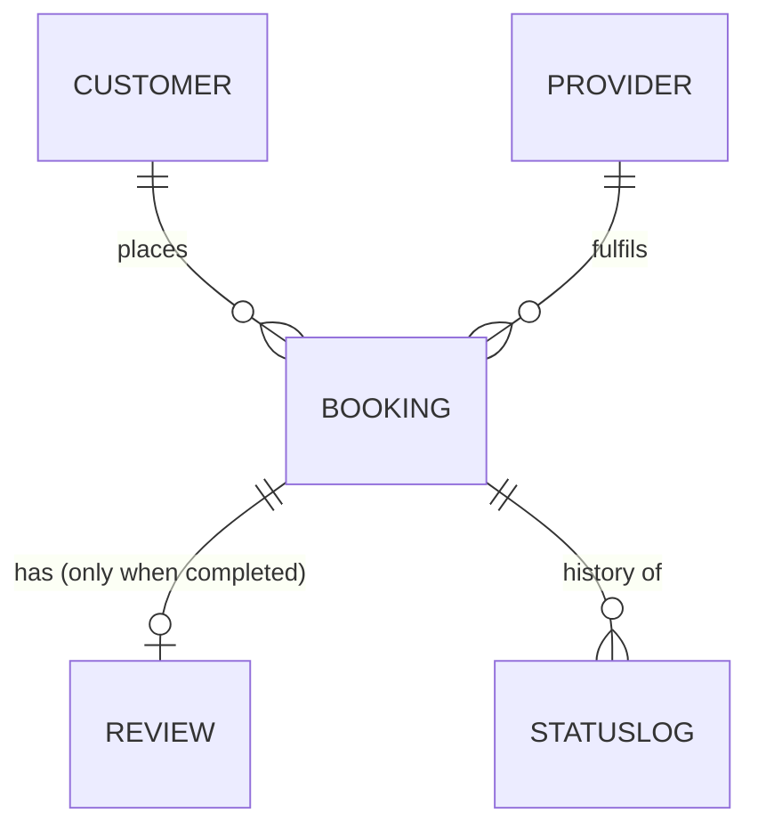

# 06 — SevaSetu: Home Services Booking API

> **One-line pitch:** A backend for an Urban-Company-style app where customers book verified
> plumbers, electricians, cleaners and AC technicians in their pincode, track the job's status,
> and leave a review afterwards.

**Difficulty:** Medium. Every core feature uses only concepts from projects 01–05. The
"Stretch" items go one step further.
**Estimated effort:** 10–15 hours across 7 milestones.
**Files you'll write:** about 15.

---

## 1. Why this project?

Each of the five practice projects taught one or two ideas in isolation. SevaSetu makes them
**work together**. A single booking request has to:

1. Read a **static catalog** (like ChaiMenu),
2. Validate a **pincode** and raise **custom exceptions** (like Pincode Lookup),
3. Store data with **SQLModel CRUD** (like Rangmanch),
4. Move through an **Enum status workflow** and show up in **stats** (like Dabbawala),
5. Link **customers ↔ bookings ↔ providers** with **relationships** and **API-key auth** (like Kitab Exchange).

---

## 2. Concept coverage map

Use this as your checklist. Every row has to show up somewhere in your code.

| Concept | Learned in | Where it appears in SevaSetu |
|---|---|---|
| `FastAPI()` app with title/description/version | 01 | `main.py` |
| Path parameters (`/services/{service_id}`) | 01 | services, customers, providers, bookings |
| Query parameters with `Query(None, description=...)` | 01, 03 | filtering services, providers, bookings |
| `HTTPException` with 404/400 | 01 | every "not found" lookup |
| `response_model` + nested response (`count` + `items`) | 01 | `GET /services` returns `ServiceListResponse` |
| Static in-memory data module (`data.py`) | 01, 02 | service catalog + serviceable pincodes |
| Custom exception classes | 02 | `PincodeNotServiceableError`, `InvalidStatusTransitionError`, ... |
| `app.add_exception_handler` + `JSONResponse` | 02 | `exceptions.py`, registered in `main.py` |
| `@field_validator` | 02 | phone, pincode, bulk list size |
| Bulk POST endpoint with a found/missing summary | 02 | `POST /areas/check-bulk` |
| SQLModel `table=True` models | 03 | `Customer`, `Provider`, `Booking`, `Review`, `StatusLog` |
| `create_engine` + `get_session` yield dependency | 03 | `database.py` |
| `lifespan` context manager (not `on_event`) | 03 | `main.py` |
| `APIRouter(prefix=..., tags=[...])` + `include_router` | 03, 04 | 7 routers in `routes/` |
| Create / Read / Update schemas | 03 | for every table |
| `model_dump(exclude_unset=True)` partial PATCH | 03, 05 | update customer, update provider |
| `Field(ge=, le=, index=, unique=)` | 03, 05 | rating, experience, email, phone |
| Pagination with `skip` / `limit` | 03, 04 | all list endpoints |
| `func.avg`, `func.count` aggregates | 03, 04 | provider rating, daily stats |
| `str, Enum` status field | 04 | `BookingStatus`, `ServiceCategory` |
| Filter by date range (`datetime.combine`) | 04 | `GET /bookings?on_date=` and `/stats/daily` |
| A dedicated stats router | 04 | `routes/stats.py` |
| Foreign keys + `Relationship(back_populates=...)` | 05 | Customer→Bookings, Provider→Bookings, Booking→Review |
| Models split into a package + avoiding circular imports | 05 | `models/` folder |
| Header-based API key auth via `Depends` | 05 | admin-only endpoints |
| Duplicate checks (email already registered) | 05 | customer/provider registration |
| `Model.model_validate(create_schema)` | 05 | creating rows |
| Action endpoints (`PATCH /{id}/sold`) | 05 | `PATCH /bookings/{id}/status`, `/providers/{id}/deactivate` |
| Text search with `.contains()` | 05 | search providers by name |

---

## 3. Tech stack and setup

```
fastapi
uvicorn[standard]
sqlmodel
```

```bash
cd 06-seva-setu
python -m venv venv && source venv/bin/activate
pip install -r requirements.txt
uvicorn main:app --reload
# open http://127.0.0.1:8000/docs
```

Database: SQLite file `sevasetu.db`, created in `lifespan` at startup.

---

## 4. Folder structure

```
06-seva-setu/
├── main.py                 # app, lifespan, exception handlers, include_router, /health
├── database.py             # engine, create_tables(), get_session()
├── auth.py                 # verify_admin_key dependency
├── exceptions.py           # custom exception classes + async handlers
├── data.py                 # SERVICE_CATALOG (list) + SERVICEABLE_PINCODES (dict)
├── enums.py                # ServiceCategory, BookingStatus, ALLOWED_TRANSITIONS
├── models/
│   ├── __init__.py
│   ├── customer.py         # Customer table + CustomerCreate/Read/Update
│   ├── provider.py         # Provider table + ProviderCreate/Read/Update
│   ├── booking.py          # Booking + StatusLog tables + schemas
│   └── review.py           # Review table + ReviewCreate/Read
├── routes/
│   ├── __init__.py
│   ├── services.py         # static catalog (read-only)
│   ├── areas.py            # pincode serviceability
│   ├── customers.py
│   ├── providers.py
│   ├── bookings.py         # the heart of the app
│   ├── reviews.py
│   └── stats.py
└── requirements.txt
```

---

## 5. Static data (`data.py`)

### 5.1 `SERVICE_CATALOG`: a list of dicts, at least 10 items

```python
{
    "id": 1,
    "name": "Tap / Leak Repair",
    "category": "plumbing",          # must match a ServiceCategory value
    "base_price": 199.0,             # price per visit
    "duration_minutes": 45,
    "description": "Fix leaking taps, pipes and joints",
    "active": True,
}
```

Spread the items over 4 categories: `plumbing`, `electrical`, `cleaning`, `ac_repair`.
Mark at least one as `"active": False`.

### 5.2 `SERVICEABLE_PINCODES`: a dict keyed by pincode, at least 12 entries

```python
"411001": {"pincode": "411001", "city": "Pune", "state": "Maharashtra", "zone": "Camp"},
```

Use at least 3 cities, with several pincodes per city.

---

## 6. Enums (`enums.py`)

```python
class ServiceCategory(str, Enum):
    PLUMBING = "plumbing"
    ELECTRICAL = "electrical"
    CLEANING = "cleaning"
    AC_REPAIR = "ac_repair"

class BookingStatus(str, Enum):
    REQUESTED = "requested"
    ACCEPTED = "accepted"
    IN_PROGRESS = "in_progress"
    COMPLETED = "completed"
    CANCELLED = "cancelled"
```

### Status state machine (important business rule)

```
requested ──► accepted ──► in_progress ──► completed
    │             │
    └─────────────┴──► cancelled
```

Write this as a dict and check it on every status change:

```python
ALLOWED_TRANSITIONS: dict[BookingStatus, set[BookingStatus]] = {
    BookingStatus.REQUESTED:   {BookingStatus.ACCEPTED, BookingStatus.CANCELLED},
    BookingStatus.ACCEPTED:    {BookingStatus.IN_PROGRESS, BookingStatus.CANCELLED},
    BookingStatus.IN_PROGRESS: {BookingStatus.COMPLETED},
    BookingStatus.COMPLETED:   set(),
    BookingStatus.CANCELLED:   set(),
}
```

---

## 7. Database models (`models/`)

### 7.1 ER diagram



### 7.2 Tables

**Customer**
| Field | Type | Rules |
|---|---|---|
| id | int, PK | auto |
| name | str | indexed |
| email | str | **unique** |
| phone | str | 10 digits, starts with 6–9 (`field_validator` on the Create schema) |
| pincode | str | 6 digits |
| created_at | datetime | `default_factory=datetime.now` |
| bookings | `list["Booking"]` | `Relationship(back_populates="customer")` |

**Provider**
| Field | Type | Rules |
|---|---|---|
| id | int, PK | auto |
| name | str | indexed |
| phone | str | unique, same validator as Customer |
| category | `ServiceCategory` | indexed |
| city | str | must be a city that exists in `SERVICEABLE_PINCODES` |
| experience_years | int | `ge=0, le=50` |
| is_active | bool | default `True` |
| bookings | `list["Booking"]` | `Relationship(back_populates="provider")` |

**Booking**
| Field | Type | Rules |
|---|---|---|
| id | int, PK | auto |
| customer_id | int | `foreign_key="customer.id"` |
| provider_id | int | `foreign_key="provider.id"` |
| service_id | int | id from `SERVICE_CATALOG` (no FK, the catalog is static) |
| pincode | str | must be serviceable |
| address | str | min length 10 |
| scheduled_for | datetime | must be in the future |
| quantity | int | `ge=1, le=5` (e.g. 2 ACs) |
| total_amount | float | **computed on the server**: `base_price * quantity`. Never accept it from the client |
| status | `BookingStatus` | default `REQUESTED` |
| created_at / updated_at | datetime | update `updated_at` on every change |
| customer / provider | relationships | `back_populates="bookings"` |
| review | `Optional["Review"]` | `back_populates="booking"` |

**StatusLog** (a **real table** this time; in Dabbawala it was only a schema)
| Field | Type |
|---|---|
| id | int, PK |
| booking_id | int, FK → booking.id |
| old_status | `BookingStatus` |
| new_status | `BookingStatus` |
| note | `Optional[str]` |
| changed_at | datetime |

**Review**
| Field | Type | Rules |
|---|---|---|
| id | int, PK | auto |
| booking_id | int | FK → booking.id, **unique** (one review per booking) |
| provider_id | int | FK → provider.id (copied from the booking for easier averaging) |
| rating | int | `ge=1, le=5` |
| comment | str | max length 500 |
| created_at | datetime | auto |

### 7.3 Schemas you need

| Table | Create | Read | Update |
|---|---|---|---|
| Customer | `CustomerCreate` | `CustomerRead` | `CustomerUpdate` (name, phone, pincode, all Optional) |
| Provider | `ProviderCreate` | `ProviderRead` | `ProviderUpdate` (phone, city, experience_years) |
| Booking | `BookingCreate` (customer_id, provider_id, service_id, pincode, address, scheduled_for, quantity) | `BookingRead` | `BookingStatusUpdate` (new_status, note) |
| StatusLog | – | `StatusLogRead` | – |
| Review | `ReviewCreate` (rating, comment) | `ReviewRead` | – |

Plus two nested response models:
- `BookingDetail`: `BookingRead` + `service_name` + `customer: CustomerRead` + `provider: ProviderRead` + `history: list[StatusLogRead]`
- `ServiceListResponse`: `status`, `count`, `items: list[ServiceItem]` (same shape as ChaiMenu's `MenuResponse`)

---

## 8. Custom exceptions (`exceptions.py`)

Each one gets its own class plus an `async` handler that returns a `JSONResponse` with this
consistent shape:

```json
{ "error": "pincode_not_serviceable", "message": "We don't serve 999999 yet", "detail": { "pincode": "999999" } }
```

| Exception | HTTP | When |
|---|---|---|
| `InvalidPincodeError` | 400 | not exactly 6 digits |
| `PincodeNotServiceableError` | 404 | 6 digits but not in `SERVICEABLE_PINCODES` |
| `ServiceUnavailableError` | 409 | service exists but `active == False` |
| `ProviderMismatchError` | 409 | provider's category ≠ service's category, **or** provider's city ≠ pincode's city, **or** provider is inactive |
| `InvalidStatusTransitionError` | 409 | e.g. `completed → requested` |
| `ReviewNotAllowedError` | 409 | booking isn't `completed` yet, or it already has a review |

Register all of them in `main.py` with `app.add_exception_handler(...)`.
Plain "not found by id" cases can keep using `HTTPException(404)`.

---

## 9. Authentication (`auth.py`)

- Header: `X-API-Key`
- `verify_admin_key(x_api_key: str = Header())` raises `401` if the key is wrong.
- **Better than Kitab:** read the key with `os.getenv("SEVASETU_ADMIN_KEY", "dev-admin-key")`
  instead of hardcoding it.

**Admin-only endpoints:** creating or deactivating providers, every `/stats/*` endpoint, and
listing all customers.
**Public endpoints:** catalog, areas, customer signup, creating bookings, reviews.

---

## 10. API endpoints

### 10.1 `routes/services.py`: prefix `/services`, tag `services` (static, read-only)
| Method | Path | Query | Response | Notes |
|---|---|---|---|---|
| GET | `/services` | `category: ServiceCategory \| None`, `active_only: bool = True` | `ServiceListResponse` | 404 if the filter returns nothing |
| GET | `/services/{service_id}` | – | `ServiceItem` | 404 if missing |

### 10.2 `routes/areas.py`: prefix `/areas`, tag `areas`
| Method | Path | Body | Response | Notes |
|---|---|---|---|---|
| GET | `/areas/{pincode}` | – | `AreaResponse` | raises `InvalidPincodeError` / `PincodeNotServiceableError` |
| POST | `/areas/check-bulk` | `{"pincodes": [...]}` (1–20 items, each validated) | `{found, not_found, serviceable: [...], missing: [...]}` | copy the Pincode-Lookup pattern |
| GET | `/areas/cities` | – | `list[str]` | unique sorted city names |

### 10.3 `routes/customers.py`: prefix `/customers`, tag `customers`
| Method | Path | Auth | Response | Notes |
|---|---|---|---|---|
| POST | `/customers` | public | `CustomerRead`, **201** | 400 if the email already exists |
| GET | `/customers` | admin | `list[CustomerRead]` | `skip`, `limit` |
| GET | `/customers/{id}` | public | `CustomerRead` | 404 |
| PATCH | `/customers/{id}` | public | `CustomerRead` | `exclude_unset=True` |
| GET | `/customers/{id}/bookings` | public | `list[BookingRead]` | uses the relationship `customer.bookings`; optional `status` filter |

### 10.4 `routes/providers.py`: prefix `/providers`, tag `providers`
| Method | Path | Auth | Response | Notes |
|---|---|---|---|---|
| POST | `/providers` | admin | `ProviderRead`, 201 | 400 on duplicate phone; 400 if the city isn't served |
| GET | `/providers` | public | `list[ProviderRead]` | filters: `category`, `city`, `name` (`.contains`), `active_only=True`, `skip`, `limit` |
| GET | `/providers/{id}` | public | `ProviderRead` | 404 |
| PATCH | `/providers/{id}` | admin | `ProviderRead` | partial update |
| PATCH | `/providers/{id}/deactivate` | admin | `ProviderRead` | sets `is_active=False` |
| GET | `/providers/{id}/rating` | public | `{provider_id, average_rating, total_reviews}` | `func.avg` + `func.count`; 404 if there are no reviews |

### 10.5 `routes/bookings.py`: prefix `/bookings`, tag `bookings` ⭐ the core
| Method | Path | Response | Notes |
|---|---|---|---|
| POST | `/bookings` | `BookingRead`, 201 | runs the **booking validation pipeline** below |
| GET | `/bookings` | `list[BookingRead]` | filters: `status`, `provider_id`, `on_date: date \| None`, `skip`, `limit` |
| GET | `/bookings/{id}` | `BookingDetail` | nested customer, provider, service name and history |
| PATCH | `/bookings/{id}/status` | `BookingRead` | checks `ALLOWED_TRANSITIONS`, writes a `StatusLog` row, bumps `updated_at` |
| GET | `/bookings/{id}/history` | `list[StatusLogRead]` | ordered by `changed_at` |

**Booking validation pipeline** (`POST /bookings`). Run the checks in this order:
1. Customer exists → otherwise 404
2. Service exists in the catalog → otherwise 404; `active` → otherwise `ServiceUnavailableError`
3. Pincode valid → `InvalidPincodeError`; serviceable → `PincodeNotServiceableError`
4. Provider exists → 404; active, same category, same city → otherwise `ProviderMismatchError`
5. `scheduled_for` is in the future → otherwise 400 (a `field_validator` in `BookingCreate` works well)
6. Compute `total_amount = base_price * quantity`
7. Save the booking **and** the first `StatusLog(old_status=None → requested)`, then commit once

### 10.6 `routes/reviews.py`: tag `reviews`
| Method | Path | Response | Notes |
|---|---|---|---|
| POST | `/bookings/{booking_id}/review` | `ReviewRead`, 201 | booking must be `completed` and must not have a review yet → otherwise `ReviewNotAllowedError` |
| GET | `/providers/{provider_id}/reviews` | `list[ReviewRead]` | `skip`/`limit`, newest first |

### 10.7 `routes/stats.py`: prefix `/stats`, tag `stats`, **admin only** (put `dependencies=[Depends(verify_admin_key)]` on the router)
| Method | Path | Response |
|---|---|---|
| GET | `/stats/daily?summary_date=YYYY-MM-DD` | `{date, total_bookings, by_status: {...}, revenue_completed}` |
| GET | `/stats/categories` | number of bookings per `ServiceCategory` |

### 10.8 `main.py`
- `GET /` returns a welcome message
- `GET /health` returns `{"status": "ok"}` (**remember the `@`**, see Pitfalls)

---

## 11. Build plan (milestones)

Finish each milestone, test it in `/docs`, and **commit** before you move on.

### Milestone 1: Skeleton and static catalog (~1h) *(01 concepts)*
- [ ] Create the folder, `requirements.txt`, and a venv
- [ ] `main.py` with title/description/version, `/` and `/health`
- [ ] `data.py` with `SERVICE_CATALOG`
- [ ] `enums.py`
- [ ] `routes/services.py` with both endpoints and the `ServiceListResponse` nested model
- ✅ **Check:** `/services?category=plumbing` works, and `/services/999` returns 404

### Milestone 2: Areas and custom exceptions (~1.5h) *(02 concepts)*
- [ ] `SERVICEABLE_PINCODES` in `data.py`
- [ ] `exceptions.py` with all 6 exception classes and handlers, registered in `main.py`
- [ ] `routes/areas.py`, including the bulk check with `field_validator`
- ✅ **Check:** `/areas/12ab` → 400 JSON, `/areas/999999` → 404 JSON, a bulk call with 21 pincodes → 422

### Milestone 3: Database and customers (~2h) *(03 concepts)*
- [ ] `database.py` (engine, `create_tables`, `get_session`)
- [ ] `lifespan` in `main.py`
- [ ] `models/customer.py` with the phone validator
- [ ] Customer CRUD with pagination and `exclude_unset`
- ✅ **Check:** a duplicate email → 400, phone `12345` → 422, and a PATCH that only sends `name` leaves the other fields alone

### Milestone 4: Providers and auth (~2h) *(05 concepts)*
- [ ] `auth.py` that reads the key from the environment
- [ ] `models/provider.py`
- [ ] Provider routes with filters, `.contains()` name search, and deactivate
- ✅ **Check:** POST without the header → 422, with the wrong key → 401, with the right key → 201

### Milestone 5: Bookings, relationships and the state machine (~3h) *(04 and 05 concepts)* ⭐
- [ ] `models/booking.py` (Booking and StatusLog) and wire up all the `Relationship`s
- [ ] Fix circular imports the way Kitab did (import at the bottom + `model_rebuild()`), or with `TYPE_CHECKING`
- [ ] The full validation pipeline in `POST /bookings`
- [ ] `PATCH /bookings/{id}/status` with `ALLOWED_TRANSITIONS` and a log row
- [ ] `GET /bookings/{id}` returning the nested `BookingDetail`
- [ ] `GET /customers/{id}/bookings` through the relationship
- ✅ **Check:** walk through the scenarios in Section 12

### Milestone 6: Reviews and ratings (~1.5h) *(03 concepts)*
- [ ] `models/review.py` with the unique `booking_id`
- [ ] Review routes and `/providers/{id}/rating` with `func.avg`
- ✅ **Check:** a review on a `requested` booking → 409, a second review → 409, and the average is rounded to 2 decimals

### Milestone 7: Stats and polish (~1.5h) *(04 concepts)*
- [ ] `routes/stats.py` with router-level auth
- [ ] Add `status_code=201` on create endpoints
- [ ] Add `description=` to every `Query()` so `/docs` reads well
- [ ] Write a `README.md` with setup steps and sample requests

---

## 12. Acceptance scenarios (manual test script)

Run these in `/docs` or with curl. They should all behave exactly as described.

| # | Scenario | Expected |
|---|---|---|
| 1 | Create customer Asha (pincode 411001) | 201 |
| 2 | Create Asha again with the same email | 400 "Email already registered" |
| 3 | Create provider Ravi (plumbing, Pune) **without** the API key | 422 (missing header) |
| 4 | Same request with the correct key | 201 |
| 5 | Asha books an **electrical** service with Ravi | 409 `ProviderMismatchError` |
| 6 | Asha books a plumbing service with Ravi at pincode 999999 | 404 `PincodeNotServiceableError` |
| 7 | Asha books a plumbing service, quantity 2, for tomorrow | 201, `total_amount = base_price × 2`, status `requested` |
| 8 | PATCH status `requested → completed` | 409 `InvalidStatusTransitionError` |
| 9 | PATCH `→ accepted → in_progress → completed` | 200 each time |
| 10 | `GET /bookings/{id}/history` | 4 rows, in order |
| 11 | Post a review (rating 5) | 201 |
| 12 | Post a second review on the same booking | 409 `ReviewNotAllowedError` |
| 13 | `GET /providers/{ravi}/rating` | `{average_rating: 5.0, total_reviews: 1}` |
| 14 | `GET /stats/daily` with the key | `completed: 1`, revenue matches |
| 15 | `GET /bookings/{id}` | nested customer, provider, service_name and history |
| 16 | Deactivate Ravi, then try to book him | 409 `ProviderMismatchError` |

---

## 13. Pitfalls spotted in your earlier projects (don't repeat them!)

1. **`04-dabbe-wala/main.py`**: `app.get("/health", ...)` is missing the `@`, so the route is
   **never registered**. Write `@app.get(...)`.
2. **`04-dabbe-wala/routes/orders.py`**: `created_date: str` is passed into `datetime.combine()`,
   which needs a `date` object, so the endpoint crashes. Declare it as `date | None` and FastAPI
   will parse it for you, the way `stats.py` already does.
3. **`04-dabbe-wala/models.py`**: `StatusLog` was never a table (`table=True` is missing), so no
   history is ever saved. In SevaSetu it **must** be a real table.
4. **`05-kitab-exchange/main.py`**: `@app.on_event("startup")` is deprecated. Use `lifespan`, as
   in 03 and 04.
5. **`05-kitab-exchange/routes/books.py`**: `BookCreate` accepts `user_id` without checking that
   the user exists. In SevaSetu, check **every** foreign id before you insert.
6. **Never trust money from the client.** Compute `total_amount` on the server.
7. **Route order matters.** Declare `/areas/cities` **before** `/areas/{pincode}`, or FastAPI will
   treat "cities" as a pincode. (Rangmanch got this right with `/average/{play_name}`.)

---

## 14. Stretch goals (do these once the core works)

- [ ] **Tests** with `fastapi.testclient.TestClient` and a separate in-memory SQLite DB, using
      `app.dependency_overrides[get_session]`. Turn Section 12 into pytest cases.
- [ ] **Settings** with `pydantic-settings` and a `.env` file (DB URL, admin key)
- [ ] **Min-rating filter**: `GET /providers?min_rating=4` (needs a subquery or join with `func.avg` + `group_by`)
- [ ] **Double-booking guard**: reject a booking if the provider already has an active booking
      within ±1 hour of `scheduled_for`
- [ ] **`/stats/top-providers?limit=5`**: ranked by completed bookings, using `group_by` + `order_by`
- [ ] **Middleware** that logs the method, path, status code and duration of every request
- [ ] **Async** version: switch to `async def` routes with `AsyncSession` + `aiosqlite`

---

## 15. Definition of done

- [ ] All 16 acceptance scenarios behave as specified
- [ ] Every row in the concept coverage map (Section 2) shows up in the code
- [ ] `/docs` shows 7 tag groups, each endpoint has a summary, and every query param has a description
- [ ] No hardcoded secrets
- [ ] The app starts on a fresh clone (`rm sevasetu.db && uvicorn main:app --reload`)
- [ ] A README with setup steps and 3–4 example curl requests
